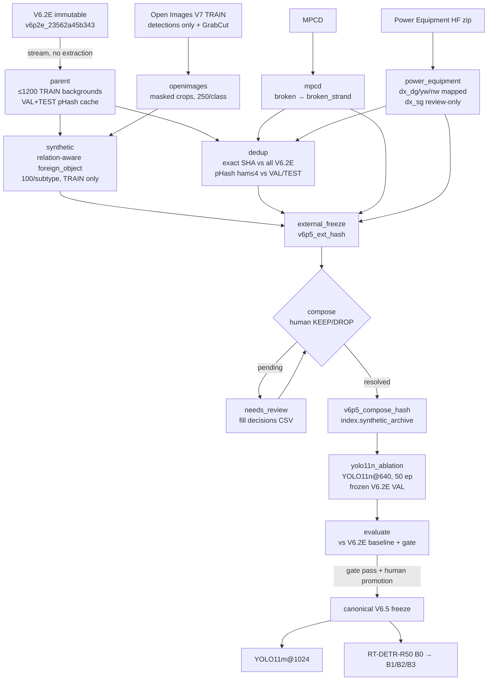

# UAV Powerline Defect Detection — `yolov11sdi` (V6.2E → V6.5)

[](https://github.com/Eau-Claire/Uav-Powerline-Defect-Detection/actions/workflows/tests.yml)

Research pipeline for **StructDETR: Structural-Consistency-Aware Detection
Transformer for UAV-Based Electrical Infrastructure Inspection**. It replaces
a chain of one-off Kaggle notebooks with one Python package that:

* runs **locally first** (Jupyter or CLI), and the **same code** runs on Kaggle (generated launchers) and Camber;
* is **resumable**: every expensive stage checkpoints to `state/<stage>.json` and reuses verified results;
* keeps **lineage**: deterministic content-derived tags, immutable freeze manifests, frozen VAL, untouched TEST.

> Current work (2026-10-26):
> * **Two-tier system** — YOLO26n student on a Raspberry Pi flags images, a YOLO26m teacher on the
>   server re-checks them. Teacher has plateaued on current labels; work moved to **data quality**
>   (leak removal v8, foreign_object test split v9). See [Results](#results-so-far).
> * **Controlled 2×6 benchmark** — Raw vs Curated data × 6 detectors (YOLO11n/m, YOLO26n/m,
>   RT-DETR-R50/R101) in [`benchmakring_transmission_line_defect_model/`](benchmakring_transmission_line_defect_model/README.md).
> * **Demo** — Streamlit app (image upload + IP camera stream) in [`demo/`](demo/README.md).

## Research lineage

| Version | Tag | Notes |
|---|---|---|
| V6.2E (canonical parent, immutable) | `v6p2e_23562a45b343` | train 17,483 / val 2,272 / test 2,012; base `56b7ea194ee5`, FOTL overlay `ee2d3c4497fd`, parent `v6p1_5d0b1149891c` |
| V6.3 ROI-A | `v6p3_roi_a_8b9ed089d547` | ×1.2 box scaling — did not fix the localization gap, rejected |
| V6.4 clean | `v6p4_clean_official` (bundle) | not exactly replayable from the bundle; not used as base |
| V6.5 external stage / compose | `v6p5_ext_<12hex>` / `v6p5_compose_<12hex>` | pipeline stages kept, but **not used for the current models** (last Kaggle run: `Compose candidates: []`); superseded by the local Roboflow ablation (`v6p5-11`) and the dataset line below |
| V6.5 v2 → v4 | `v6p5_v2..v4` | teacher/distill iterations: 6-class v3 (SAM-tightened boxes), v4 adds `person` |
| V6.5 v5 | `v6p5_v5` | **7 classes** (insulator filled, `person`); reference teacher `v5_orig` (YOLO26m) + Pi student `n_v5` (YOLO26n) |
| V6.5 v6 / v7 | `v6p5_v6`, `v6p5_v7` | v6: foreign_object reviewed; v7: auto box fixes from teacher — no effect (A/B +0.0003) |
| V6.5 v8 | `v6p5_v8` | v6 minus 170 train images near-duplicating val; `val_clean_v8` (+11 bird_nest, −2 broken); `leaked_val.txt` |
| V6.5 v9 | `v6p5_v9` | v8 + held-out `test_fo` (145 images, 150 FO boxes, cluster-aware); only v9-trained models may be scored on it |

## Classes (fixed order — part of the dataset contract)

| id | class | meaning / note |
|---|---|---|
| 0 | `insulator` | whole insulator — base object the detector anchors on |
| 1 | `insulator_broken` | broken / missing disc, broken glass |
| 2 | `insulator_flashover` | flashover / arc burn marks |
| 3 | `bird_nest` | bird nest on tower / line (may later fold into foreign_object) |
| 4 | `foreign_object` | kite, balloon, plastic bag, etc. on or near the line |
| 5 | `broken_strand` | broken / fractured conductor strand, cable discontinuity |
| 6 | `person` | **v5 and later only** (lineworkers; stops the teacher calling them foreign_object) |

The 2×6 benchmark and the pipeline stages use the 6-class contract (0–5). Headline metric for the
two-tier work: **MEAN_5** = mean AP50 over the 5 defect classes (1–5), not mAP over all classes.

## Data sources

In V6.2E: **ZHENG1600, IDID, CPLID, VPMBGI, InsuFault, FOTL/EFOD_Drone**.
Added by V6.5: **Open Images V7** (foreign-object appearance only), **MPCD** (broken_strand),
**Power Equipment Image Dataset** (`dx_dg/yw/nw`; `dx_sg` review-only),
**Roboflow transmission-detection v1** (local ablation `v6p5-11`).
Availability notes: the public MPCD Google Drive file was removed (2026-10) — the `mpcd` stage now
records it as `unavailable` and continues; Power Equipment was dropped from the Roboflow ablation
because ~86% of it is already in V6.2E.
Studied but not merged: Insulator-DET, BGI, CPMID, TLID, Porcelain Disk Insulator 2026, MPID,
InsPLAD, TTPLA, TL-Defect5K.
Citations: [References](#references) below · per-source usage details: [`docs/DATA_SOURCES.md`](docs/DATA_SOURCES.md).

## Results so far

### Two-tier system on leak-free val (`val_clean_v8`, 2,123 images)

Models trained on v5. Pi `n_v5` flags an image when conf ≥ 0.05; server teacher `v5_orig` runs foreign_object at imgsz 800,
other classes at 640. Source: [`artifacts/eval_v8/report.md`](artifacts/eval_v8/report.md).

| configuration | MEAN_5 |
|---|---:|
| Pi student `n_v5` alone | 0.761 |
| teacher `v5_orig` alone | 0.818 |
| **two-tier `n_v5 → v5_orig`** | **0.817** [CI95 0.79–0.85] |

Per class (two-tier, AP50): broken 0.847 · flashover 0.841 · bird_nest 0.927 · foreign_object 0.688 ·
broken_strand 0.784. The 0.82 target is not reached with confidence (P(>0.82) ≈ 51%).
Gentle fine-tune, weight soups, FO@1024, TTA and WBF did not beat `v5_orig`; a hand-crafted
structural-consistency score gave no extra signal over loss/confidence (blind check of 205 boxes).
broken_strand is a **domain** problem: AP50 0.827 on square ground/phone images vs 0.570 on drone images.
Details: [`docs/SESSION_2026-10-15_v6p5_plateau.md`](docs/SESSION_2026-10-15_v6p5_plateau.md),
weekly log [`docs/NHAT_KY_TUAN_2026-10-18.md`](docs/NHAT_KY_TUAN_2026-10-18.md).

### 2×6 benchmark: Raw vs Curated — all 12 runs (`val_clean` split)

Raw / Curated = the **training** data. All 12 runs are scored on the same split with the **Curated** labels
(`dataset_curated.yaml` for YOLO, `curated_combined/data_val_clean.yaml` for RT-DETR), so the columns are
directly comparable.

> ⚠️ Despite the `test` key, both `dataset_raw.yaml` and `dataset_curated.yaml` set `test: images/val_clean`,
> not the frozen V6.2E TEST (2,012 images). For Curated, `val_clean` is also the `val` split used to pick
> `best.pt`, and it very likely still contains the 148 images that near-duplicate train (found in v6, removed in v8).
> These numbers are therefore optimistic; re-score the checkpoints on `images/test` (and on `val_clean`
> minus `leaked_val.txt`) before citing them. Source: `benchmakring_transmission_line_defect_model/results_yolo_model/`
and `results_rtdetr/` (`benchmark_test_results.json`). YOLO runs evaluated with `best.pt` (2026-10-23),
RT-DETR with `last.pt` (2026-10-25). Latency / FPS / VRAM: single-image inference on the RTX 4060 benchmark
machine. MEAN_5 = mean AP50 of the 5 defect classes (insulator excluded).

#### Overall

| model | data | P | R | F1 | mAP50 | mAP50:95 | MEAN_5 | Params (M) | GFLOPs | Latency (ms) | FPS | VRAM (MB) |
|---|---|---:|---:|---:|---:|---:|---:|---:|---:|---:|---:|---:|
| YOLO11n | Raw | 0.805 | 0.697 | 0.747 | 0.756 | 0.409 | 0.719 | 2.59 | 6.5 | 10.61 | 94.3 | 76 |
| YOLO11n | Curated | 0.816 | 0.720 | 0.765 | 0.791 | 0.430 | 0.763 | 2.59 | 6.5 | 13.35 | 74.9 | 76 |
| YOLO11m | Raw | 0.826 | 0.744 | 0.783 | 0.798 | 0.439 | 0.764 | 20.06 | 68.3 | 13.04 | 76.7 | 289 |
| YOLO11m | Curated | 0.818 | 0.763 | 0.789 | 0.810 | 0.457 | 0.783 | 20.06 | 68.3 | 14.88 | 67.2 | 288 |
| YOLO26n | Raw | 0.815 | 0.722 | 0.766 | 0.781 | 0.422 | 0.745 | 2.51 | 5.9 | 12.16 | 82.2 | 74 |
| YOLO26n | Curated | 0.828 | 0.744 | 0.784 | 0.812 | 0.440 | 0.786 | 2.51 | 5.9 | 14.12 | 70.8 | 75 |
| YOLO26m | Raw | 0.830 | 0.765 | 0.796 | 0.809 | 0.448 | 0.776 | 21.78 | 75.0 | 15.72 | 63.6 | 290 |
| YOLO26m | Curated | 0.860 | 0.781 | 0.819 | 0.832 | 0.469 | 0.807 | 21.78 | 75.0 | 16.29 | 61.4 | 288 |
| RT-DETR-R50 | Raw | 0.823 | 0.796 | 0.805 | 0.782 | 0.430 | 0.752 | 42.74 | 137.7 | 37.44 | 26.7 | 414 |
| RT-DETR-R50 | Curated | 0.876 | 0.800 | 0.836 | 0.802 | 0.439 | 0.778 | 42.74 | 137.7 | 38.31 | 26.1 | 414 |
| RT-DETR-R101 | Raw | 0.838 | 0.794 | 0.812 | 0.787 | 0.435 | 0.760 | 76.40 | 260.6 | 54.94 | 18.2 | 546 |
| RT-DETR-R101 | Curated | 0.885 | 0.804 | 0.842 | 0.816 | 0.451 | 0.791 | 76.40 | 260.6 | 54.63 | 18.3 | 546 |

#### Per-class AP50

| model | data | insulator | broken | flashover | bird_nest | foreign_obj | strand | MEAN_5 |
|---|---|---:|---:|---:|---:|---:|---:|---:|
| YOLO11n | Raw | 0.944 | 0.760 | 0.707 | 0.837 | 0.574 | 0.716 | 0.719 |
| YOLO11n | Curated | 0.930 | 0.775 | 0.722 | 0.909 | 0.687 | 0.724 | 0.763 |
| YOLO11m | Raw | 0.965 | 0.823 | 0.797 | 0.851 | 0.606 | 0.745 | 0.764 |
| YOLO11m | Curated | 0.944 | 0.820 | 0.777 | 0.903 | 0.684 | 0.733 | 0.783 |
| YOLO26n | Raw | 0.958 | 0.808 | 0.750 | 0.828 | 0.579 | 0.761 | 0.745 |
| YOLO26n | Curated | 0.944 | 0.809 | 0.782 | 0.906 | 0.654 | 0.776 | 0.786 |
| YOLO26m | Raw | 0.975 | 0.846 | 0.800 | 0.865 | 0.588 | 0.780 | 0.776 |
| YOLO26m | Curated | 0.956 | 0.851 | 0.803 | 0.932 | 0.699 | 0.752 | 0.807 |
| RT-DETR-R50 | Raw | 0.931 | 0.807 | 0.740 | 0.876 | 0.591 | 0.749 | 0.752 |
| RT-DETR-R50 | Curated | 0.921 | 0.807 | 0.741 | 0.889 | 0.697 | 0.755 | 0.778 |
| RT-DETR-R101 | Raw | 0.923 | 0.818 | 0.704 | 0.890 | 0.629 | 0.759 | 0.760 |
| RT-DETR-R101 | Curated | 0.936 | 0.820 | 0.746 | 0.917 | 0.735 | 0.740 | 0.791 |

#### Per-class AP50:95

| model | data | insulator | broken | flashover | bird_nest | foreign_obj | strand |
|---|---|---:|---:|---:|---:|---:|---:|
| YOLO11n | Raw | 0.660 | 0.386 | 0.284 | 0.470 | 0.317 | 0.337 |
| YOLO11n | Curated | 0.620 | 0.394 | 0.282 | 0.513 | 0.421 | 0.353 |
| YOLO11m | Raw | 0.688 | 0.426 | 0.331 | 0.499 | 0.349 | 0.341 |
| YOLO11m | Curated | 0.653 | 0.428 | 0.334 | 0.554 | 0.435 | 0.335 |
| YOLO26n | Raw | 0.657 | 0.410 | 0.305 | 0.474 | 0.334 | 0.353 |
| YOLO26n | Curated | 0.631 | 0.409 | 0.309 | 0.528 | 0.407 | 0.357 |
| YOLO26m | Raw | 0.702 | 0.438 | 0.334 | 0.504 | 0.346 | 0.364 |
| YOLO26m | Curated | 0.666 | 0.441 | 0.341 | 0.562 | 0.449 | 0.356 |
| RT-DETR-R50 | Raw | 0.617 | 0.405 | 0.307 | 0.526 | 0.376 | 0.351 |
| RT-DETR-R50 | Curated | 0.624 | 0.406 | 0.300 | 0.536 | 0.418 | 0.351 |
| RT-DETR-R101 | Raw | 0.627 | 0.409 | 0.289 | 0.519 | 0.414 | 0.353 |
| RT-DETR-R101 | Curated | 0.648 | 0.415 | 0.307 | 0.546 | 0.442 | 0.345 |

#### Curated − Raw (per-class AP50)

| model | insulator | broken | flashover | bird_nest | foreign_obj | strand | MEAN_5 | mAP50 | mAP50:95 |
|---|---:|---:|---:|---:|---:|---:|---:|---:|---:|
| YOLO11n | -0.014 | +0.014 | +0.015 | +0.072 | +0.113 | +0.008 | +0.044 | +0.035 | +0.022 |
| YOLO11m | -0.022 | -0.003 | -0.019 | +0.052 | +0.078 | -0.012 | +0.019 | +0.012 | +0.017 |
| YOLO26n | -0.014 | +0.001 | +0.032 | +0.077 | +0.076 | +0.016 | +0.040 | +0.031 | +0.018 |
| YOLO26m | -0.019 | +0.005 | +0.003 | +0.068 | +0.111 | -0.028 | +0.032 | +0.023 | +0.021 |
| RT-DETR-R50 | -0.010 | +0.000 | +0.001 | +0.014 | +0.106 | +0.006 | +0.025 | +0.019 | +0.009 |
| RT-DETR-R101 | +0.013 | +0.002 | +0.041 | +0.027 | +0.106 | -0.020 | +0.031 | +0.028 | +0.015 |

Takeaways:
* Curation helps **every** model: +0.012 … +0.035 mAP50, +0.009 … +0.022 mAP50:95, +0.019 … +0.044 MEAN_5.
* The gain comes almost entirely from **foreign_object** (+0.08 … +0.11 AP50) and **bird_nest** (+0.01 … +0.08);
  `insulator` drops slightly (−0.01 … −0.02) for most models; broken / flashover / strand change little (±0.04).
* Best overall: **Curated YOLO26m** (mAP50 0.832, mAP50:95 0.469, MEAN_5 0.807). Best per parameter: Curated
  YOLO26n (MEAN_5 0.786 at 2.5 M params) — above Raw YOLO26m (0.776).
* RT-DETR-R101 has the best curated foreign_object (0.735) but is ~3.4× slower than YOLO26m (54.6 vs 16.3 ms).

The auto-generated `results_rtdetr/factorial_benchmark_report.md` predates the RT-DETR runs (shows N/A);
use the tables above or `benchmark_summary.csv`.

### Early V6.5 data ablation (YOLO11n@640, frozen V6.2E VAL)

| dataset | mAP50 | mAP50:95 | gap |
|---|---|---|---|
| V6.2E original | 0.768 | 0.413 | 0.355 |
| V6.3-ROI-A candidate (×1.2 boxes) | 0.794 | 0.431 | 0.364 |

Per class (V6.2E): insulator .934/.638 · broken .800/.407 · flashover .755/.326 ·
bird_nest .831/.455 · foreign_object .537/.295 · broken_strand .749/.356 (AP50/AP50:95).
YOLO11m@1024 (V6.2E, 40 ep): 0.815 / 0.457 / gap 0.358. V6.4 post-clean (YOLO11m@1024, RAW VAL): ≈0.839 / 0.472 / gap 0.367.

### Diagnosis

* The model **recognizes the right classes, but boxes are loose**: the mAP50 → mAP50:95 gap stays ≥ 0.3
  for every version (and ~0.36 even with more capacity / resolution).
* mAP improves slowly between epochs.
* Classification is fine → predictions are **conservative** → many **missed objects** → low recall,
  which also drags strict-IoU (localization) metrics down.
* Earlier analysis: tiny boxes do not explain the gap; predicted/GT area ratio ≈ 1; ROI-A box scaling
  did not fix it → class-specific **box semantics / extent consistency** is the main suspect
  (flashover, broken_strand), while foreign_object is mainly a **recall / coverage** problem —
  the target of the V6.5 data ablation.

### Data checklist (per source)

`pytest -v tests/test_data_checklist.py` runs one test per step:

- [x] raw sources pinned (version / id / repo + file)
- [x] canonicalize taxonomy (all mappings land in 0..5; `dx_sg` never mapped)
- [x] canonicalize bbox (VOC px → normalized YOLO, clipped, degenerate boxes dropped)
- [x] QA per source (review manifest per source, external_eval never → TRAIN, nothing pre-approved)
- [x] provenance preserved (source, split, original path, sha256, license; synthetic keeps both lineages)
- [x] dedup / near-dup grouping (exact SHA vs every V6.2E split, pHash ≤ 4 grouping)
- [x] split (V6.2E counts verified vs manifest; deterministic external split ≈ 80/20)
- [x] freeze (content-derived tag, policy flags, immutable registry)

These tests check the **code paths**; whether the real V6.5 sources pass is only known after
`notebooks/03` runs (results land in `state/dedup.json` and the freeze).

## Pipeline



## Directory structure

```text
configs/            YAML configs (base -> v6p2e -> v6p5_external -> v6p5_compose -> yolo11n_ablation;
                    yolo11n_local, yolo11m_1024, rtdetr_b0)
notebooks/          01..06: ordered pipeline steps (generated by scripts/build_notebooks.py);
                    00/07: Roboflow ablation on Studio; 08: restore the 2026-10-15 session on a new machine
src/yolov11sdi/     package: config, paths, environment, state, hashing, io_utils,
                    archive_utils, camber, pipeline, dataset/ (incl. roots.py), qa/, training/, reporting/
scripts/            pipeline CLI: run_stage.py, status.py, sync_camber.py, verify_artifacts.py,
                    export_kaggle.py, build_notebooks.py, package_dataset.py, export_model.py, train*.py
                    dataset builds: build_v6.py .. build_v9.py; audits: label_audit_*.py, audit_v6_boxes.py,
                    sam_tighten.py, strand_v8.py, struct_audit.py; experiments: exp_*.py, eval_v8.py, proto_diffusion_*.py
tests/              unit tests + data checklist + offline end-to-end smoke test
data/               bulky regenerable data (not committed) — see data/README.md
artifacts/          remote_mirror/, freezes/, manifests/, qa/, compose/, exports/ (pipeline);
                    eval_v8/, review_v7/, struct_audit/, pi_v8/, pi_bench_v5/, exp_student_res/, ... (experiments)
runs/               training runs (weights, results.csv, run_state.json)
state/              <stage>.json — resume/progress records (commit these)
logs/               logs/<stage>/<timestamp>.log
legacy/notebooks/   historical Kaggle / local notebooks v6p1..v6p5-26 (read-only, see INDEX.csv)
benchmakring_transmission_line_defect_model/   2×6 Raw-vs-Curated benchmark (own README, configs, results)
demo/               Streamlit defect-detection demo (image upload + IP camera)
weights/            pretrained base weights (yolo26n.pt)
dist/kaggle/        generated Kaggle launchers
docs/               DATA_SOURCES.md (citations), VERSIONING.md, MIGRATION_PLAN.md (2026-10-07, historical),
                    SESSION_2026-10-15_v6p5_plateau.md, NHAT_KY_TUAN_*.md (weekly logs), context/
```

## Local setup

```bash
git clone https://github.com/Eau-Claire/Uav-Powerline-Defect-Detection.git
cd Uav-Powerline-Defect-Detection
python -m venv .venv-research
source .venv-research/bin/activate
pip install -e ".[dev,notebook]"          # core + tests + Jupyter
pip install -e ".[stage]"                 # data staging: imagehash, OpenCV, FiftyOne 1.22.1, gdown, HF hub
pip install -e ".[train]"                 # GPU training: ultralytics 8.4.172 (+ torch)
python -m ipykernel install --user --name yolov11sdi --display-name "yolov11sdi (.venv-research)"
pytest
```

(`.venv/` is the existing FiftyOne viewer environment; the research venv is `.venv-research/`.)

### Camber

Install the CLI (`curl -sL https://cli.cambercloud.com/install-v2.sh | bash`) or use
`drone-modal/.tools/camber` via `export CAMBER_BIN=...`. Authenticate with
`camber login` **or** `export CAMBER_API_KEY=...` (see `.env.example`; never commit `.env`).
Camber is optional for local work: without it outputs stay local and can be pushed later
with `scripts/sync_camber.py`. Remote paths are unchanged from the Kaggle era.

## Jupyter workflow

```bash
jupyter lab notebooks/
```

Only the ordered steps needed to train on the newest dataset. Each notebook starts with a
**"DATASET TRÊN CAMBER"** cell: the exact Camber input/output paths, the tags in use
(`EXTERNAL_STAGE`, `COMPOSE`; `None` = automatic) and a check that Camber is reachable
(storage is primarily Camber; `REQUIRE_CAMBER=False` for a purely local run).

| Step | Notebook | Camber input → output |
|---|---|---|
| 01 | `01_setup_and_check` | — (env, deps, Camber login, status) |
| 02 | `02_prepare_parent_v6p2e` | `datasets/v6p2e/v6p2e_23562a45b343/` + base/overlay archives → `v6p5_external_stage/parent_cache/` (pHash cache) |
| 03 | `03_build_external_stage_v6p5` | Open Images / MPCD / Power Equipment → `v6p5_external_stage/v6p5_ext_<12hex>/` + `mpcd/`, `power_equipment/` |
| 04 | `04_review_and_compose_v6p5` | `v6p5_ext_<12hex>` → `compose_qa/v6p5_compose_<12hex>/` (+ `compose_qa/review_decisions/`) |
| 05 | `05_train_yolo11n_640_ablation` | `v6p5_compose_<12hex>` → `checkpoints/v6p5_data_ablation/v6p5_y11n_ablation_<12hex>/` |
| 06 | `06_evaluate_vs_v6p2e_baseline` | run report → comparison CSV next to the run on Camber |

Other notebooks in `notebooks/` (not generated, edit by hand):

| Notebook | Purpose |
|---|---|
| `00_studio_pull_v6p5_roboflow` | Studio setup: pull the built `v6p5_roboflow_ablation` dataset + `best.pt` of run `20261009T024019Z_roboflow` from Camber (download/verify only) |
| `07_resume_v6p5_12_adamw_studio` | resume the `v6p5-12` AdamW + cosine Roboflow ablation on Studio |
| `08_resume_session_20261015` | restore the 2026-10-15 session (code bundle, v6/v7 data, weights, prediction caches) and re-check its numbers without GPU |

**V6.5 Raspberry Pi students on any GPU (local or rented) — `legacy/notebooks/v6p5/v6p5-20_20261013-v5-students-n-s-anywhere.ipynb`:**
`git pull`, put `CAMBER_API_KEY=...` in `.env`, install the Camber CLI and `pip install ultralytics==8.4.172 ncnn pnnx pandas`
(+ torch with CUDA), then **Run All** (over SSH: run it with `jupyter nbconvert --to notebook --execute
--ExecutePreprocessor.timeout=-1 --output run <notebook>` inside `tmux`). It downloads and verifies the `v6p5_v5` dataset
(sha256) and the v5 teacher/student from Camber, picks batch / workers / cache from VRAM, OS and free disk, distills
YOLO26n (fine-tune from v5) and YOLO26s (from COCO) from the v5 teacher, exports NCNN for the Pi, evaluates (val +
val_clean, mAP50 / mAP50-95 per class, MEAN_5) and uploads to `checkpoints/<RUN_NAME>_<date>/` on Camber. Interrupted?
Run it again: finished stages are skipped, the running one resumes. Smoke test first with `DRY_RUN=1`.
Pi speed for n vs s: `artifacts/pi_bench_v5/` (models on Camber, see its README). Dataset tar: `scripts/package_dataset.py`.
Current Pi package: [`artifacts/pi_v8/`](artifacts/pi_v8/README.md) — `n_v5` exported to NCNN at 640×640 and
640×480 (same output as `.pt` on 40/40 4:3 drone images) + `pi_bench.py` (300 s run: latency, temperature,
throttling). **No real Pi timing has been recorded yet.**

YOLO11m@1024 / RT-DETR notebooks are added only after canonical V6.5 is frozen
(configs already exist: `configs/yolo11m_1024.yaml`, `configs/rtdetr_b0.yaml`).
Old Kaggle notebooks: `legacy/notebooks/` (renamed `<version>-<NN>_<date>_<content>[__FINAL|__EXECUTED]`, see its `INDEX.csv`).

Notebooks only call `yolov11sdi.pipeline.run_stage(...)`; set `FORCE_REBUILD=True` in a
notebook only when you really want to rebuild.

## CLI

```bash
python scripts/status.py                    # stage table, disk, checkpoint, pending reviews
python scripts/status.py --remote           # + read-only Camber tag listing
python scripts/run_stage.py parent          # default = resume/reuse
python scripts/run_stage.py external        # parent .. external_freeze in order
python scripts/run_stage.py compose         # exit code 2 = needs human review
python scripts/run_stage.py yolo11n_ablation
python scripts/run_stage.py evaluate
python scripts/run_stage.py synthetic --force
python scripts/run_stage.py dedup --dry-run
python scripts/verify_artifacts.py          # sha256 + archive integrity vs freezes/state
```

Stages: `parent, openimages, mpcd, power_equipment, synthetic, dedup, external_freeze,
compose, yolo11n_ablation, evaluate`.

## 2×6 benchmark (Raw vs Curated)

Self-contained sub-project: [`benchmakring_transmission_line_defect_model/`](benchmakring_transmission_line_defect_model/README.md).
Raw = uncurated V6.2E combined data; Curated = `v6p5_6cls_v3` after the 8-rule curation (flip fixes,
missing nests, pruned synthetic pastes, human review, SAM 2.1-b box tightening). All 12 runs are scored on
the same `val_clean` split (not the frozen TEST — see the warning in Results). Run `benchmark_pipeline.ipynb` (YOLO, RTX 4060, resumable);
RT-DETR runs were trained on Kaggle (`kaggle_train_rtdetr*.ipynb`). Upload YOLO runs to Camber with
`scripts/upload_yolo_runs_to_camber.py --dry-run` first.

## Demo app

[`demo/`](demo/README.md): Streamlit app that runs a trained checkpoint (default
`benchmakring_transmission_line_defect_model/runs/curated_yolo26n/weights/best.pt`, override with
`MODEL_PATH`) on uploaded images or a live IP-camera stream (MJPEG from IP Camera Lite, or RTSP).

```bash
cd demo
pip install -r requirements.txt
cp .env.example .env        # set CAMERA_STREAM_URL; never commit .env
streamlit run app.py
```

## Kaggle workflow

```bash
python scripts/export_kaggle.py    # -> dist/kaggle/KAGGLE_0{3,4,5}_*.ipynb (same step numbers as notebooks/)
```

Each launcher embeds a zip of `src/` + `configs/` (re-export after every change), installs only
the needed extras, reads `CAMBER_API_KEY` from Kaggle Secrets, uses `/kaggle/working/yolov11sdi`
purely as a cache and uploads persistent outputs to Camber. Config hashes and dataset tags are
identical to local runs (verified). After a Kaggle restart, "Run all": training restores
`last.pt` + `run_state.json` from `checkpoints/v6p5_data_ablation/<run_tag>/` and resumes.

## Checkpoint / resume

* `state/<stage>.json`: `status` (running/complete/failed/needs_review/stale), config hash,
  input + output SHA256, progress, summary, history of stale records.
* A complete stage is reused when its stage-specific config hash, input hashes and outputs match.
  Changing a semantic config key marks the old record `stale` (kept in history) and reruns.
  `runtime:` keys never affect hashes.
* Incremental checkpoints: pHash (partial CSV), background pool (deterministic files),
  Open Images (per class), synthetic (per subtype), downloads (verified local mirror),
  archives (deterministic, digest-matched).
* Training: `runs/<family>/<experiment>__<compose_tag>/` with `weights/{best,last}.pt`,
  `results.csv`, `args.yaml`, `experiment_manifest.json`, `run_state.json`. `last.pt` +
  matching train hash ⇒ `resume=True`. A material change (model/imgsz/epochs/batch/seed/
  dataset/compose) moves the old run to `<run>__stale_<hash>` — never deleted.
  Checkpoints sync to Camber every `training.sync_every_epochs` (best effort).

### Recover after a kernel crash / reboot

```bash
python scripts/status.py                       # see what is running/failed
python scripts/run_stage.py <same stage>       # resumes from the last checkpoint
```

## Tests

```bash
pytest            # integrity checks + data checklist + offline end-to-end smoke test
```

The smoke test runs every stage on tiny fake data (downloads and GPU training stubbed):
parent streaming, pHash, direct overlays, synthetic, dedup, freeze, review gate, compose,
dataset build with TEST/VAL guards, report and evaluate, plus resume/reuse.
GitHub Actions runs it on every push (`.github/workflows/tests.yml`).

## Versioning

See `docs/VERSIONING.md`. Short version: code = git tag `vX.Y.Z` + commit recorded everywhere;
data = content-addressed tags; experiment ID `v6p5-abl01-yolo11n-640-e50`; each run's
`run_state.json → sessions[]` lists which commit trained which epochs.

## Artifact naming

| Artifact | Name | Identity |
|---|---|---|
| External stage | `v6p5_ext_<12hex>` | SHA256 over sorted `relpath:sha256` of the overlay dir |
| Compose | `v6p5_compose_<12hex>` | SHA256 of {stage tag, overlay SHA, review decisions, approved synthetic archive SHA, taxonomy} |
| Training dataset | `v6p5_ablation_ds_<12hex>` | SHA256 of the dataset manifest (split/file/origin/sha) + compose tag |
| Remote run | `v6p5_y11n_ablation_<12hex>` | legacy formula {compose tag, model, imgsz, epochs, train count} |

Never timestamps. Local mirror: `artifacts/remote_mirror/<path after stash://bunpmc/projects/yolov11sdi/>`.
Manifests store project-relative paths (`data/...`, `artifacts/...`).

## Data policy

* **TEST is immutable** and never materialized for training. **VAL is frozen** (exact V6.2E VAL SHA set).
* Open Images V7 TRAIN (Balloon, Kite, Plastic bag, Bird, Person) = **appearance source only**;
  `annotation_download=detections_only`, `mask_strategy=local GrabCut foreground mask from
  detection bbox`, `openimages_segmentation_zip_downloaded=false`, `SYNTH_REQUIRE_MASK=True`.
  Generic objects become `foreign_object` only when composited near an insulator on internal
  TRAIN backgrounds (TRAIN only).
* MPCD broken/fracture/discontinuity → `broken_strand`. PowerEquipment `dx_dg→broken_strand`,
  `yw→foreign_object`, `nw→bird_nest`, `dx_sg` review-only. Non-train source splits →
  `external_eval`, never into V6.2E val/test.
* Low disk: streaming tar reads, bounded pool, early archive deletion, detections-only Open Images.

## QA / review policy

* Review manifest `v6p5_candidate_review_manifest.csv` (review_id, candidate_type, overlay_image,
  overlay_label, source, target_split, mapped_class_names, subtype, recommended_action, decision,
  reviewer, comment). Decisions go into `artifacts/qa/v6p5_review_decisions.csv`: `KEEP`, `DROP`, blank.
* `REVIEW_THEN_KEEP` is a recommendation; compose stops with `needs_review` while any TRAIN
  candidate is blank. `compose.auto_approve_recommended` exists only as an explicit, recorded override.
* Exact SHA duplicates vs V6.2E = hard gate. pHash candidates vs VAL/TEST must be reviewed
  (`compose.allow_phash_candidates` recorded in the freeze).
* Synthetic samples intentionally use internal TRAIN backgrounds and are not counted as leakage.
* Only KEEP'ed direct rows enter training (`training.direct_filter_by_review`; see MIGRATION_PLAN C3).

## References

If you use this pipeline or its derived data, cite the original datasets below and respect each
source's license (see [`docs/DATA_SOURCES.md`](docs/DATA_SOURCES.md) for how each one is used).
Entries marked *link TODO* still need their official URL.

### Datasets in the canonical V6.2E parent

1. **ZHENG1600** — Zheng et al. "Insulator-Defect Detection Algorithm Based on Improved YOLOv7."
   *Sensors* 22(22):8801, 2022. https://doi.org/10.3390/s22228801
2. **IDID** — Lewis & Kulkarni. "Insulator Defect Detection" [dataset]. IEEE DataPort.
   https://doi.org/10.21227/vkdw-x769
3. **CPLID** — Tao et al. "Detection of Power Line Insulator Defects Using Aerial Images Analyzed
   With Convolutional Neural Networks." *IEEE Transactions on Systems, Man, and Cybernetics: Systems*.
   https://doi.org/10.1109/TSMC.2018.2871750
4. **VPMBGI** — merged Vietnamese public broken-glass insulator dataset (no canonical paper; cite the
   upstream sources listed in its repository). *link TODO*
5. **InsuFault** — "InsuFault-Net: A Deep Learning-Based Insulator Defect Detection Algorithm for
   Transmission Lines" (official repository). *link TODO*
6. **FOTL / EFOD_Drone** — Gao et al. "YOLOv11-Based UAV Foreign Object Detection for Power
   Transmission Lines." MDPI, 2025. *DOI TODO*

### Datasets added by V6.5

7. **Open Images V7** — Kuznetsova et al. "The Open Images Dataset V4: Unified Image Classification,
   Object Detection, and Visual Relationship Detection at Scale." *International Journal of Computer
   Vision*, 2020. https://arxiv.org/abs/1811.00982 · https://storage.googleapis.com/openimages/web/index.html
8. **MPCD** — Benelmostafa & Medromi. "PowerLine-MTYOLO: A Multitask YOLO Model for Simultaneous Cable
   Segmentation and Broken Strand Detection." *Drones* 9(7):505, 2025.
   https://doi.org/10.3390/drones9070505 · https://github.com/phd-benel/PowerLine-MTYOLO
9. **Power Equipment Image Dataset** — Xiong et al. "Object recognition for power equipment via
   human-level concept learning." *IET Generation, Transmission & Distribution* 15(10):1578–1587, 2021.
   https://doi.org/10.1049/gtd2.12088 · https://github.com/xiongsiheng/Power-equipment-image-dataset

### Studied, not merged (candidate / external evaluation / reference)

10. **Insulator-DET** — Li et al. "TLINet." *PLOS ONE*, 2025. *DOI TODO*
11. **CPMID** — "Cross-scale recognition of dense insulators and defects in complex power grid
    environments." *Engineering Applications of Artificial Intelligence*, 2025.
    https://doi.org/10.1016/j.engappai.2025.113283
12. **TLID** — Hu et al. "Towards Defect Detection of Transmission Line Insulator: A Dataset, Benchmarks
    and Challenges." ICPRE 2025. https://doi.org/10.1109/ICPRE67300.2025.11274094
13. **Porcelain Disk Insulator 2026** — Mendeley Data, CC BY 4.0. https://doi.org/10.17632/5pwrd7gmw2.1
14. **MPID** — "APF-YOLOv8: Enhancing Multiscale Detection and Intra-Class Variance Handling for
    UAV-Based Insulator Power Line Inspections." Dataset: https://doi.org/10.5281/zenodo.14604384
15. **InsPLAD** — Vieira e Silva et al. "InsPLAD: A Dataset and Benchmark for Power Line Asset
    Inspection in UAV Images." 2023. https://doi.org/10.1080/01431161.2023.2283900
16. **TTPLA** — Abdelfattah et al. "TTPLA: An Aerial-Image Dataset for Detection and Segmentation of
    Transmission Towers and Power Lines." ACCV 2020.
17. **TL-Defect5K** — Jia. "Mamba-enhanced detection transformer with selective state space models for
    multi-category defect detection in transmission lines." *Discover Computing* 29(1):489, 2026.
    https://link.springer.com/article/10.1007/s10791-026-10353-0 · https://github.com/Dali8710/TL-Defect5K
18. **BGI** — broken-glass insulator dataset, predecessor of VPMBGI. *link TODO*

19. **Roboflow transmission-detection v1** — Roboflow Universe, CC BY 4.0 (`cable_defectueux → broken_strand`,
    `rubbish → foreign_object`; used in the `v6p5-11` ablation). *link TODO*

### Models and tools

20. **YOLO11** — Jocher & Qiu. *Ultralytics YOLO11*, 2024. https://github.com/ultralytics/ultralytics
21. **YOLO26** — Ultralytics YOLO26 (NMS-free), via `ultralytics==8.4.172`. https://github.com/ultralytics/ultralytics
22. **RT-DETR** (StructDETR B0 baseline) — Zhao et al. "DETRs Beat YOLOs on Real-time Object
    Detection." CVPR 2024. https://arxiv.org/abs/2304.08069

## Current status (2026-10-26)

* **Models in use:** server teacher `v5_orig` (YOLO26m, FO@800) + Pi student `n_v5` (YOLO26n).
  Two-tier MEAN_5 0.817 on leak-free val; teacher plateaued on current labels.
* **Data:** `v6p5_v9` built (v8 leak-free train + `test_fo` 145 images / 150 FO boxes). Only the Pi-student
  resolution study (`scripts/exp_student_res.py`, `v6p5-26`) trained on v9: `n_640` −0.019 MEAN_5 vs `n_v5`,
  `n_800` ≈ `n_v5` (−0.001, CI95 ±0.02) → `n_v5` stays the Pi model. No teacher on v9 yet; `test_fo` not scored yet.
* **Benchmark:** all 12 Raw/Curated runs evaluated; Curated YOLO26m is best (mAP50 0.832, MEAN_5 0.807); full per-class tables in Results.
* **Open:** ~80 small `insulator_broken` boxes need an expert check; broken_strand needs real drone images;
  Pi NCNN timing not run on the device; the original Kaggle `v6p5_ext_*` / `v6p5_compose_*` path was never completed.

Next (from the 2026-10-18 weekly log): settle labels → full retrain (not fine-tune from `v5_orig`) on v9 with one
recipe → score on `val_clean_v8` + `test_fo`; run `pi_bench.py` on the Pi to pick 640×640 vs 640×480.

---

## FiftyOne viewer for the Power Equipment dataset (existing tool)

```bash
python -m venv .venv && source .venv/bin/activate && pip install -r requirements.txt
yay -S mongodb-bin && sudo systemctl enable --now mongodb
./run_fiftyone.sh            # http://127.0.0.1:5151
```

`Power-equipment-image-dataset/` is a clone of the upstream repo (not vendored here, 1.3 GB):

```bash
git clone https://github.com/xiongsiheng/Power-equipment-image-dataset.git
cd Power-equipment-image-dataset && git apply --ignore-whitespace ../tools/power_equipment/local_src_changes.patch
```

Helper scripts: `Power-equipment-image-dataset/src/{data_stat,unique_types_extractor,copy_example_images}.py`.
The V6.5 pipeline itself downloads the Power Equipment zip from Hugging Face, not this clone.
