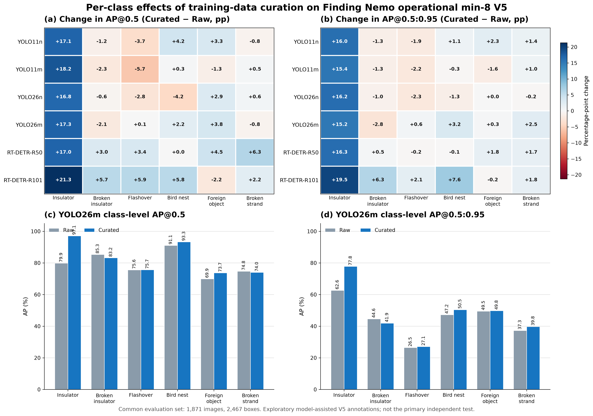

### 5.4 Per-class outcomes and qualitative error analysis

***Figure RC-3.*** *Per-class effects of Raw and Curated training on the common Finding Nemo operational min-8 V5 evaluation set. Panels (a) and (b) report Curated-minus-Raw changes in AP50 and AP50:95 across all six detectors. Panels (c) and (d) show the corresponding absolute class-level scores for YOLO26m. Positive heatmap values indicate higher performance after curation. The V5 annotations are exploratory and model-assisted; therefore, this analysis does not replace the primary independent test benchmark.*

| **Class / detector** | **V5 outcome** | **Interpretation** |
|---|---:|---|
| **insulator / all detectors** | AP50 improves by +16.81 to +21.31 pp | The largest and most consistent Raw-to-Curated difference, but its magnitude should be interpreted in light of the model-assisted V5 annotation additions. |
| **foreign_object / YOLO26m** | 0.6993 → 0.7370 (+3.77 pp) | Curated training improves AP50, consistent with cleaner foreign-object supervision. |
| **bird_nest / YOLO26m** | 0.9110 → 0.9330 (+2.20 pp) | A moderate AP50 improvement is accompanied by a +3.23 pp AP50:95 gain. |
| **insulator_broken / YOLO26m** | 0.8532 → 0.8324 (−2.08 pp) | The curated checkpoint performs worse for this class under both AP50 and AP50:95. |
| **broken_strand / YOLO26m** | AP50 −0.75 pp; AP50:95 +2.48 pp | Lower loose-IoU AP but better strict localization indicates that conclusions depend on the IoU range used. |
| **RT-DETR-R101** | Five of six classes improve in AP50 | The exception is foreign_object (−2.24 pp), showing that curation effects remain architecture-dependent. |

***Table RC-11.*** *Selected positive and negative class-level changes on the common operational min-8 V5 annotations. Values are descriptive comparisons of fixed Raw and Curated checkpoints, not rule-level causal effects.*

The class-level results show that a positive overall average does not imply uniform improvement. The clearest change is observed for `insulator`, whose AP50 increases for all six detector architectures. Across models, the mean class-level AP50 changes are +17.95 percentage points for `insulator`, +0.44 for `insulator_broken`, −0.48 for `insulator_flashover`, +1.38 for `bird_nest`, +1.82 for `foreign_object`, and +1.34 for `broken_strand`. The unusually large `insulator` gain must be interpreted cautiously because V5 adds model-assisted consensus annotations for missing healthy-insulator instances. Consequently, V5 is useful for exploratory annotation analysis but is not an independent ground-truth replacement.

For YOLO26m, curation improves `insulator`, `insulator_flashover`, `bird_nest`, and `foreign_object` AP50, while `insulator_broken` and `broken_strand` decline. The `broken_strand` result is metric-dependent: AP50 decreases slightly, whereas AP50:95 improves. This pattern is compatible with altered localization behavior on thin targets, but it does not establish a causal effect for any individual curation rule. Rule-level ablation or matched-image error inspection is required before attributing the change to a specific operation.

For the final qualitative figure, the same V5 images should be shown in three aligned columns: ground truth, Raw YOLO26m predictions, and Curated YOLO26m predictions. The examples should include improvements for `foreign_object` and `bird_nest`, a degraded `insulator_broken` case, a thin `broken_strand` localization case, one false positive shared by both checkpoints, and one multi-class scene. Both checkpoints must use identical confidence, NMS, resolution, and visualization settings.
